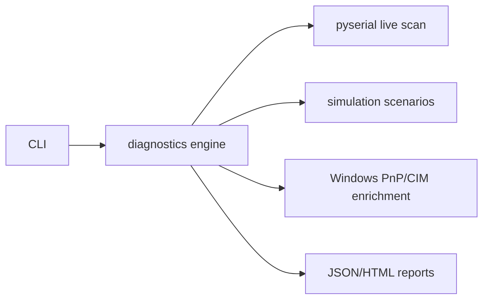

# USB Serial Driver Diagnostics Lab

[](https://github.com/guilherme-lacerda-tech/usb-serial-driver-diagnostics-lab/actions/workflows/ci.yml)
[](https://github.com/guilherme-lacerda-tech/usb-serial-driver-diagnostics-lab/actions/workflows/security.yml)
[](https://github.com/guilherme-lacerda-tech/usb-serial-driver-diagnostics-lab/releases)
[](LICENSE)

Windows-focused USB serial diagnostics lab with a professional Python CLI, controlled port probing, simulation mode and structured JSON/HTML reporting.

Portuguese documentation: [README.pt-BR.md](README.pt-BR.md) and [docs/hardware-validation.md](docs/hardware-validation.md).

## Why

USB serial failures are often blamed on "the COM port" when the real issue is driver state, device identity, stale handles, missing VID/PID metadata, disconnected hardware, timeout settings or another process holding the port. This project demonstrates a public, synthetic troubleshooting workflow for those cases without exposing corporate devices, logs or infrastructure.

## Features

- COM port discovery through `pyserial`.
- Windows PnP enrichment through PowerShell/CIM when running on Windows.
- VID/PID, manufacturer, description, location and PnP status modeling.
- Controlled serial open attempt with timeout and probe payload.
- Busy port, missing driver, disconnected device and timeout classification.
- Mandatory hardware-free simulation mode.
- Synthetic scenarios for healthy device, missing driver, busy port, timeout, disconnected device, unknown VID/PID and communication failure.
- JSON and HTML report generation with checks, warnings, errors and recommendations.

## Architecture



## Tech Stack

- Python 3.11+
- `pyserial`
- PyTest
- coverage.py
- Ruff
- GitHub Actions
- CodeQL and dependency review

## Quick Start

```bash
python -m pip install -e ".[dev]"
usb-serial-diagnostics list-scenarios
usb-serial-diagnostics simulate --scenario healthy --json reports/healthy.json --html reports/healthy.html
```

For a live scan:

```bash
usb-serial-diagnostics scan --baudrate 115200 --timeout 1.0
```

Live scanning is intentionally conservative. It opens the port with a timeout, sends a small ASCII probe payload and reports whether bytes were returned. Hardware behavior depends on the attached device and firmware.

## Demo / Simulation

Simulation mode is the primary public demo path and works without hardware:

```bash
usb-serial-diagnostics simulate --scenario port_busy
usb-serial-diagnostics simulate --scenario driver_missing
usb-serial-diagnostics simulate --scenario timeout
```

All example devices, VID/PID pairs and serial identifiers are synthetic.

## Tests

```bash
python -m ruff check .
python -m pytest --cov --cov-report=term-missing -q
```

The test suite covers scenario classification, parser behavior, timeout/busy/missing-device diagnosis and report generation.

## Project Structure

```text
src/usb_serial_driver_diagnostics_lab/
  cli.py
  diagnostics.py
  models.py
  reports.py
  simulation.py
  windows_inventory.py
tests/
docs/
examples/
```

## Engineering Decisions

- Simulation mode is mandatory because CI and public demos cannot depend on hardware.
- Live probing is intentionally shallow and timed to avoid destructive or vendor-specific behavior.
- Windows-specific enrichment is optional. The core parser and simulator run cross-platform.
- The CLI uses the standard library `argparse` to keep installation simple while still exposing professional commands.

## Security

This repository uses synthetic data only. It must not contain real customer devices, serial numbers, IMEI/ICCID, internal APNs, endpoints, logs, corporate commands or private screenshots.

## Limitations

- Hardware validation is pending.
- The live communication probe cannot infer proprietary protocols.
- Windows PnP enrichment runs only when PowerShell and CIM are available.

## Related Projects

- [iot-serial-diagnostics-tool](https://github.com/guilherme-lacerda-tech/iot-serial-diagnostics-tool): related general serial diagnostics project.
- This repository is the deeper Windows USB/driver/COM troubleshooting lab.

## Roadmap

- Add richer Windows driver error mapping.
- Add optional Rich output for tabular CLI summaries.
- Add pluggable public device profiles for common USB serial chipsets.

